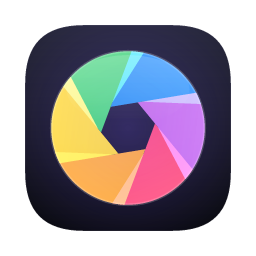

<p align="center"></p>

<h1 align="center">Photo Studio</h1>

<p align="center">A fast, native, layer-based photo editor for macOS, Windows and Linux.<br>
One self-contained binary, no runtime, works offline.</p>

<p align="center"><a href="https://photo-studio.devops-monk.com">Website</a> ·
<a href="https://github.com/devops-monk/photo-studio/releases/latest">Download</a></p>

## Features

- **51 tools**: marquees, lasso, polygonal and magnetic lasso, Object Selection, Quick Selection, magic wand, crop, eyedropper, ruler, spot healing, Remove, healing, Patch, Content-Aware Move, red eye, brush, pencil, clone, pattern and history brushes, three erasers, gradient, paint bucket, blur, sharpen, smudge, Liquify, dodge, burn, sponge, horizontal and vertical type, Pen and Direct Selection, eleven shapes, hand and zoom
- **Layers**: pixel, type, shape, fill (solid, gradient, pattern) and adjustment layers; groups (pass-through or isolated); smart objects with editable smart filters and lossless transforms; layer masks, clipping masks, 27 blend modes, opacity and fill opacity, locks and color labels
- **Ten layer styles**: Bevel & Emboss, Stroke, inner and outer shadows and glows, Satin, and color, gradient and pattern overlays
- **16 adjustments**, live as adjustment layers or applied directly, plus Auto Tone, Auto Contrast, Auto Color, Equalize and Shadows/Highlights
- **31 filters** with live preview inside the selection, including Iris and Tilt-Shift blur, Reduce Noise, Liquify-style distortions, Oil Paint and Lens Flare
- **Content-aware**: Content-Aware Fill (⇧⌫), the Remove brush, Patch and Content-Aware Move
- **Selections**: Select Subject, Color Range, Quick Mask (Q), saved selections, feather, expand, contract, border and smooth
- **Paths**: Bézier paths become selections, fills, strokes or shape layers
- **Brushes**: presets with angle, roundness, scatter, size and opacity jitter, and stroke smoothing
- **Workflow**: rulers, guides, grid and snapping; a ⌘F command palette; Actions that record, replay and batch-process folders; unlimited visual history
- **Files**: layered `.pstudio` projects; PSD and OpenRaster with groups; SVG, OpenEXR and HDR; and PNG, JPEG, WebP, TIFF, BMP, GIF, TGA, ICO, QOI and PNM
- Light and dark themes, and keyboard shortcuts familiar from other editors

## Install

Download the build for your platform from [Releases](https://github.com/devops-monk/photo-studio/releases/latest):

| Platform | File |
|---|---|
| macOS (Apple Silicon and Intel) | `photo-studio-<ver>-macos-universal.dmg` |
| Windows x64 / ARM64 | `photo-studio-<ver>-windows-<arch>.zip` |
| Ubuntu / Debian | `photo-studio_<ver>_<arch>.deb` |
| Any Linux | `.AppImage` or `.tar.gz` |

macOS builds aren't notarized yet. On first launch, right-click the app and choose **Open**.

## Command line

```sh
photo-studio-cli photo.jpg --adjust autotone --filter unsharp=80,1.5 -o photo-fixed.jpg
photo-studio-cli batch ./raw --out-dir ./web --format webp --resize 1600
photo-studio-cli list    # every adjustment and filter
```

## Build from source

```sh
cargo run --release -p photo-studio          # desktop app
cargo test --workspace                       # engine and UI tests
cargo run -p photo-studio --example gen_icons  # regenerate icons
```

On Linux, install `libxkbcommon-dev libwayland-dev libxcb-render0-dev libxcb-shape0-dev libxcb-xfixes0-dev libgtk-3-dev` first.
If the GPU driver is old, set `PHOTO_STUDIO_RENDERER=glow`.

## Releasing

Push a tag such as `git tag v0.1.0 && git push origin v0.1.0`. GitHub Actions builds every platform and publishes the release.

## License

MIT © 2026 Abhay Pratap Singh. Bundled fonts are under the SIL Open Font License (see `assets/fonts`).
